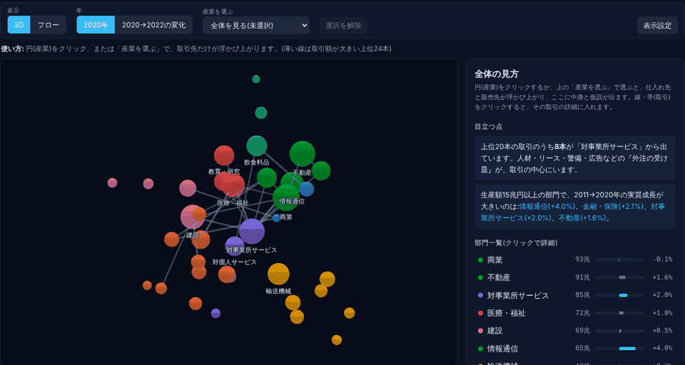
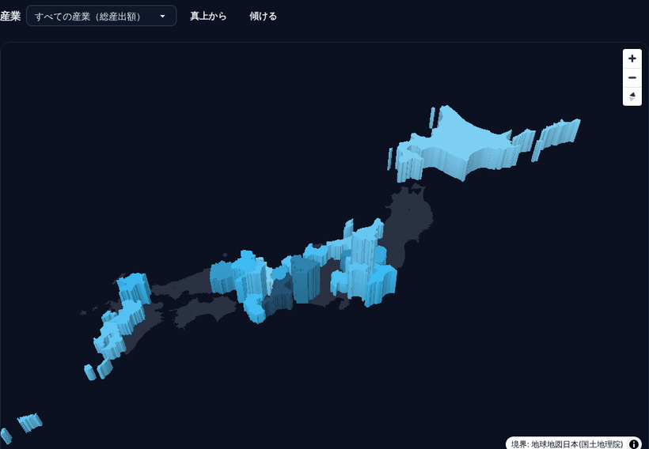

# Keizai Atlas（経済の地図帳）

**https://keizai-atlas.com** ― 日本の公的統計（産業連関表など）で、産業のつながりや地域の産業構造を眺める趣味のサイトです。



- **産業マップ**: 37産業の取引を3Dのネットワークで表示。産業を選ぶと仕入れ先・販売先が浮かび上がり、取引ごとに筆者の仮説（確からしさ・確かめ方つき）を読めます。
- **県別の立体地図**: 都道府県の得意な産業（特化係数）を高さで表示。
- **108産業・37部門・24都道府県の個別ページ**: 規模・成長・取引先。業界研究や探究学習にも使えます（[就活・転職・探究に使う](https://keizai-atlas.com/learn)）。
- **最新動向・円安・国際比較**: 日銀・経産省・財務省・OECD のデータを毎週自動で取り込み。



作り方は Qiita の記事「[産業連関表を3Dで可視化して「日本経済の地図帳」を作った](https://qiita.com/Haradasn/items/cbe422339fa409dbb1ec)」で紹介しています。

技術: Python（pandas・Jinja2）で静的サイトを生成 / Tailwind CSS + daisyUI / 3d-force-graph・MapLibre GL JS / Cloudflare Workers（静的アセット + D1）/ GitHub Actions（データ更新・テスト・監視）。費用ゼロで運用しています。

数値・図は公的統計を筆者が加工したもので、政府が作成したものではありません。「仮説」は筆者の推測です。

## 構成
- `site/` 公開ディレクトリ（index / explorer / about、`assets.css`、`vendor/` に3d-force-graph同梱）
- `pages/` 各ページの本文(`*.html`)、`meta.json`(title/description/埋め込みデータ)、`palette.json`(色の定義)、`charts.js`(共通グラフ)
- `scripts/build/build_site.py` HTML生成（Python + `pip install jinja2 pandas`。ひな形は `templates/`）、`npm run build:css` でTailwind+daisyUIをビルド
- `pipeline/` データ加工スクリプト（元データはe-Statから取得。パスは各スクリプト冒頭を参照）
- `data/` 加工済みCSV/JSON

## データ加工パイプライン（`pipeline/`）
`scripts/ops/run_all.sh` で、原本→加工済みデータ(`data/`)→サイトを一括生成します。`scripts/ops/run_all.sh --site` はサイトのビルドのみ。
- 原本（e-Statの産業連関表xlsx、延長表など）は `raw/` に置きます（git管理外。`KEIZAI_RAW` で場所を変更可）。出力先は `data/`（`KEIZAI_OUT` で変更可）。パスは `pipeline/_paths.py` に集約。
- 再現性の確認済み：原本から再生成した `data/` は、コミット済みのものとバイト単位で一致します。
- `build_explorer.py` 産業マップ用データ / `similarity_map.py` 近さの地図（MDS）
- `icio_agg.py` OECD ICIO 国際比較 / `boj_nowcast.py` 日銀 / `nowcast2.py` 経産省・財務省
- 大きな元データ（ICIO等）はリポジトリに含めない。各スクリプト冒頭の引数を参照。

## 開発
```
npm install
python3 scripts/build/build_site.py && npm run build:css
npx serve site   # または python3 -m http.server -d site
```
## 最新動向の自動更新
`.github/workflows/monthly-update.yml` が毎週月曜に日銀・経産省・財務省の最新データを取得し（`scripts/ops/fetch_latest.sh`）、更新があれば PR を自動作成します。本文の数字は `scripts/build/derive.py` がデータから計算して `pages/*.html` の `{{名前}}` に差し込みます。解釈の文章は人間（または Claude）が確認します。
PR 作成には、GitHub の Settings > Actions > General > Workflow permissions で「Allow GitHub Actions to create and approve pull requests」を有効にしてください。

## テスト
```
pip install pytest playwright && playwright install chromium
python3 scripts/build/build_site.py && pytest tests/
```
全ページのJSエラー、内部リンク、sitemap、フロー図ボタン、近さの地図、グラフ描画を確認します。PRごとに GitHub Actions（`.github/workflows/test.yml`）でも実行されます。

## デプロイ
Cloudflare（Workers 静的アセット、商用可）: Build command `npm install && npm run build:css`、Deploy command `npx wrangler deploy`（公開フォルダは `wrangler.jsonc` で `site`）。Vercel Hobbyは非商用のみ。

## 出典・ライセンス
データ出典：総務省ほか「産業連関表」、経済産業省「延長産業連関表」「第3次産業活動指数」、財務省「貿易統計」、日本銀行、OECD ICIO（政府統計の総合窓口 e-Stat）。本リポジトリの数値・図は筆者による加工物で、政府が作成したものではありません。ストーリーは筆者の仮説です。

## SNS共有画像(OGP)
`python3 scripts/build/build_ogp.py` で `site/og.png` と `site/og/<id>.png`(145枚)を生成します(Noto Sans CJK が必要。CIでは実行せず、生成物をコミット)。産業データが変わったら `build_site.py` → `build_ogp.py` の順に実行して再コミットしてください。

## 県別ページ
`pref_raw/` に各県の公表ファイル(出典は `pref_raw/SOURCES.json`)、`pipeline/pref_build.py` が `data/pref_37.json` を作り(需要側・費用側の収支が合うことを検証)、`scripts/build/build_pref.py` がページを作ります。県の追加は、公表ファイルを `pref_raw/` に置いて SOURCES.json に追記します。政府サイトはサンドボックスから取れないため、`pref-fetch` ワークフロー(手動実行)でファイルを取得できます。

## 開発

- 整形: `npm run format`（JS は prettier、Python は ruff）。設定は `.prettierrc.json` と `pyproject.toml`。
- ビルド: `npm run build`（ページ生成と出力HTMLの整形）、`npm run build:css`
- テスト: `npm run build && python3 -m pytest tests -q`
