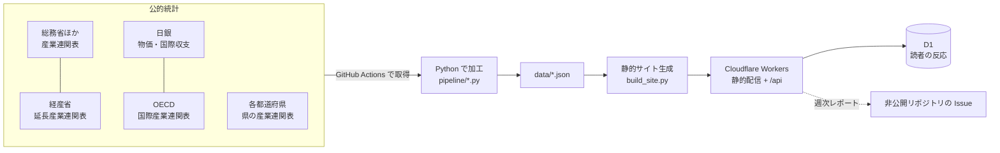

## はじめに：なぜ作ったか

日経業界地図をパラパラ眺めていて、こう思いました。

- 業界ごとの「プレーヤー」はよく分かる。でも、**業界と業界がどうつながっているか**は見えにくい。
- 自動車が売れると、鉄鋼、部品、物流、広告……と、どこまでお金が流れていくのか。
- 「目立たないけど、実は経済を支えている産業」はどこなのか。

調べてみると、それを数字で表した公的統計がありました。**産業連関表**です。国内の産業どうしが「誰から何円買って、誰に何円売ったか」を、巨大な表にまとめたものです。

ただ、これは Excel の数字の海です。眺めても全体像は頭に入ってきません。そこで、いろいろな可視化ライブラリで「絵」にしてみたら、思った以上に面白かったので紹介します。

できたもの：**Keizai Atlas**（https://keizai-atlas.com）
ソースコード：https://github.com/Haradasn/keizai-map （データの加工、サイトの生成、自動更新のワークフローまで、すべて公開しています）

この記事で紹介すること：

- 産業連関表のデータを、どう加工して可視化用のデータにしたか（データのサンプルつき）
- **3d-force-graph** で、37産業の取引ネットワークを3Dで描く
- **MapLibre GL JS** で、都道府県を「産業の強さ」で立ち上げる立体地図
- 費用ゼロで運用するための構成（静的サイト＋Cloudflare Workers＋GitHub Actions）
- ハマったところ

:::note info
数値はすべて公的統計を筆者が集計したものです。政府が作成・保証したものではありません。投資などの判断には使わないでください。
:::

## 全体の構成

最初に決めたのは「**月0円で動かす**」ことです。趣味なので、サーバー代を払い続けたくありません。



| 役割 | 使ったもの |
|---|---|
| データ加工 | Python（pandas, numpy, openpyxl） |
| サイト生成 | 自前の Python スクリプト（テンプレート＋数値の差し込み） |
| 見た目 | Tailwind CSS + daisyUI |
| 3Dネットワーク | 3d-force-graph（three.js ベース） |
| 立体地図 | MapLibre GL JS（`fill-extrusion`） |
| 配信 | Cloudflare Workers の静的アセット（無料枠） |
| 自動更新 | GitHub Actions（毎週、日銀などの最新値を取得して PR を作る） |
| テスト | pytest + Playwright（全ページを実ブラウザで開いて確認） |

フレームワークは使わず、**Python でHTMLを書き出すだけ**の静的サイトにしました。ページ数は約180ありますが、ビルドは4秒ほどで終わります。

## データ：産業連関表を「ノードとエッジ」にする

### 産業連関表とは

ものすごくざっくり言うと、こういう表です（単位：兆円、数字は説明用）。

| 買い手→<br>売り手↓ | 農業 | 自動車 | サービス | 家計など（最終需要） | 生産額 |
|---|---:|---:|---:|---:|---:|
| 農業 | 1 | 0 | 2 | 8 | 11 |
| 自動車 | 0 | 20 | 1 | 26 | 47 |
| サービス | 1 | 5 | 13 | 66 | 85 |

縦に読むと「その産業が何を仕入れたか（費用）」、横に読むと「何を誰に売ったか（販売先）」が分かります。

これはそのまま**グラフ（ネットワーク）**とみなせます。

- **ノード**：産業（37部門、細かくすると108部門）
- **エッジ**：「売り手 → 買い手」の取引額

### 加工後のデータ（サンプル）

e-Stat の Excel から、ノードとエッジの CSV を作ります。

```text:data/nodes.csv（37部門の先頭。単位は10億円）
code  name              output   intermediate_purchases  imports
01    農林漁業           12365.8   6608.4                  2317.1
06    鉱業                 506.5    220.8                 13918.5
11    飲食料品           38063.9  24456.9                  7635.9
15    繊維製品            2910.9   1654.4                  4601.2
16    パルプ・紙・木製品  11440.2   7095.0                  2174.6
```

```text:data/edges.csv（37部門で取引額が大きい順）
src     dst     amount   share_of_buyer_cost
S37_35  S37_35  20478.7  0.433   # 輸送機械 → 輸送機械（部品の取引）
S37_66  S37_66  12776.7  0.151   # 対事業所サービス → 同
S37_20  S37_64  10858.9  0.151   # 化学製品（医薬品）→ 医療・福祉
S37_59  S37_59  10685.7  0.164   # 情報通信 → 同
S37_66  S37_59  10609.7  0.163   # 対事業所サービス → 情報通信
```

`share_of_buyer_cost` は「買い手の費用のうち、この取引が何割か」です。たとえば医療・福祉の費用の約15%が、化学製品（ほぼ医薬品）の仕入れだと読めます。

### 計算：投入係数とレオンチェフ逆行列

産業連関分析の基本は、この2つです。

```python:pipeline/analysis.py（抜粋）
import numpy as np

A = Z / X                                  # 投入係数：買い手の生産1円あたりの仕入れ
m = IMP / (Z.sum(1) + Fd)                  # 輸入係数：国内需要に占める輸入の割合
I = np.eye(len(X))
B = np.linalg.inv(I - (I - np.diag(m)) @ A)  # 輸入を除いたレオンチェフ逆行列

# 検算：最終需要から生産額を再現できるか
Xhat = B @ ((I - np.diag(m)) @ Fd + E)
assert np.abs(Xhat - X).max() / X.max() < 1e-6
```

`B` があると、「建設に1兆円の需要が増えたら、どの産業の生産がいくら増えるか」が計算できます。

統計の加工では、**検算の assert を必ず入れる**ようにしました。元の表の列を1つ読み違えるだけで、全部の数字がおかしくなるからです。

## ライブラリ紹介1：3d-force-graph で産業ネットワークを3Dにする


[3d-force-graph](https://github.com/vasturiano/3d-force-graph) は、three.js の上にネットワーク図を描くライブラリです。ノードとリンクの配列を渡すだけで、回転・ズームできる3Dグラフになります。

```html
<script src="vendor/3d-force-graph.min.js"></script>
<div id="graph"></div>
<script>
// 実際のコードを簡略化したもの
const Graph = ForceGraph3D()(document.getElementById("graph"))
  .graphData({
    // 位置は固定（同じ部門グループが近くに来るよう事前に計算した x,y,z）
    nodes: D.nodes.map(n => ({ ...n, fx: n.x, fy: n.y, fz: n.z * 0.6 })),
    links: D.edges.map(e => ({ source: e.s, target: e.t, v: e.v }))
  })
  .nodeVal(n => n.out)                          // 円の大きさ＝生産額
  .nodeColor(n => GROUP_COLORS[n.grp])          // 色＝部門グループ
  .linkWidth(l => 0.3 + Math.sqrt(l.v) * 0.5)   // 線の太さ＝取引額
  .linkDirectionalParticles(2)                  // 線の上を粒が流れる（お金の流れ）
  .onNodeClick(n => select(n.id));
</script>
```

### 最初は「毛玉」だった

最初の版は、取引の上位70本を全部描いていました。結果は見事な毛玉です。ラベルは重なって読めず、誰が誰と取引しているのか全く追えません。

改善したのは次の3点です。

1. **最初は薄い線を24本だけ**にする。
2. **産業を選ぶと、その仕入れ先・販売先の上位6つだけを光らせて**、他は暗くする。
3. ラベルは**大きい産業12個＋選んだ産業の取引先だけ**に出す。

「全部見せる」より「1つ選ぶと関係が浮かぶ」ほうが、圧倒的に読めるようになりました。

### 3Dは「インパクト」、2Dは「読みやすさ」

3Dは奥行きのせいで円の大きさを比べにくい、という欠点があります。そこで、同じデータを2Dのフロー図（サンキー図風）でも見られるようにしました。こちらは自前の SVG です。


3Dと2Dの両方を用意して、切り替えられるようにするのがおすすめです。

## ライブラリ紹介2：MapLibre GL JS で都道府県を「立ち上げる」


都道府県も、それぞれ産業連関表を公表しています。これを集めて、「産業を選ぶと、その産業の生産額が大きい県ほど高く立ち上がる」地図にしました。

[MapLibre GL JS](https://maplibre.org/) の `fill-extrusion` レイヤーを使うと、GeoJSON のポリゴンを高さ付きで描けます。**地図タイルを使わず、背景を単色にした**ので、APIキーも利用料も要りません。

```js
const map = new maplibregl.Map({
  container: "pm-map",
  style: { version: 8, sources: {}, layers: [
    { id: "bg", type: "background", paint: { "background-color": bgColor } }
  ]},
  center: [137.5, 37.2], zoom: 4.6, pitch: 45, bearing: -12,
});
map.on("load", () => {
  map.addSource("pref", { type: "geojson", data: prefGeoJSON });
  map.addLayer({
    id: "ext", type: "fill-extrusion", source: "pref",
    paint: {
      "fill-extrusion-color": ["get", "c"],   // 色＝特化係数
      "fill-extrusion-height": ["get", "h"],  // 高さ＝産出額
      "fill-extrusion-vertical-gradient": true,
    },
  });
});
// 産業を切り替えたら、各県の h と c を計算し直して setData するだけ
```

県の形は、国土地理院の「地球地図日本」を GeoJSON にしたものを、shapely で間引いて使いました（約13MB → 約100KB）。

```python:scripts/build_geo.py（抜粋）
from shapely.geometry import shape, mapping, MultiPolygon

g = shape(feature["geometry"]).simplify(0.012, preserve_topology=True)
parts = [p for p in (g.geoms if g.geom_type == "MultiPolygon" else [g])
         if p.area > 0.015]          # 小さな島は落とす
```

### 特化係数：「その県が、全国よりどれだけ偏っているか」

色に使っているのは**特化係数**です。

> 特化係数 ＝（その県の産出額に占めるその産業の割合）÷（全国での割合）

たとえば愛知県の輸送機械は、県の産出額の20.3%を占めます。全国では4.6%なので、特化係数は**約4.4**です。県別のデータは、こんな形にそろえました。

```json:data/pref_37.json（愛知県・輸送機械。金額は百万円）
{ "c": "35", "n": "輸送機械",
  "out": 16268026.6, "share": 0.203, "nat_share": 0.046, "lq": 4.41,
  "va_ratio": 0.218, "exp_ratio": 0.69, "imp_ratio": 0.405 }
```

一覧にすると、各県の「得意な産業」がはっきり見えます。


### 県のデータ集めが一番大変だった

都道府県の表は、**県ごとに形式がバラバラ**です。

- 37部門の県もあれば、39部門（農・林・漁が別）や397部門の県もある。
- 単位が百万円の県もあれば、万円や千円の県もある。
- 部門コードが全国と同じ県もあれば、01からの連番の県もある。
- そもそも PDF でしか公表していない県もある。

そこで「どのシートの何行目からが表か」を設定ファイルに書き、読み込んだあとに**必ず収支が合うかを検算する**ようにしました。

```json:pref_raw/SOURCES.json（群馬県の例）
{ "gunma": { "name": "群馬県", "year": 2020, "file": "gunma_2020_37.xlsx",
             "sheet": "2-（1）", "name_row": 4, "first": 5,
             "code_col": 1, "name_col": 2,
             "url": "https://toukei.pref.gunma.jp/gio/gio2020.html" } }
```

```python:pipeline/pref_build.py（検算の部分）
mi = dem + exp - X      # 移輸入 = 域内需要 + 移輸出 - 生産額（需給の収支から）
assert abs(intin + va - X) <= max(2, X * 1e-6), (pref, sector, "費用側が合わない")
assert mi >= -max(2, X * 1e-6), (pref, sector, "移輸入が負になる")
```

この検算のおかげで、列の読み違えや単位の違いに何度も気づけました。今は24都道府県を表示しています。残りの県は、機械で読める形式の表が見つかっていません。

### 小ネタ：沖縄の「はめ込み」

実際の位置で描くと、沖縄と南西諸島が地図の下のほうに長く伸びて、文字と重なってしまいます。トップページだけは、紙の地図と同じように**四国の南の海上に「はめ込み」**で表示しました。座標をずらして、点線の枠を描いているだけです。

## 円安の影響も計算してみた

読者の方から「為替に役立つ情報が欲しい」という要望が届いたので、ページを1つ足しました。


日銀の輸入物価指数には、**円ベース**と**契約通貨ベース**があります。その比を取ると、値上がりのうち「為替による分」の目安になります。2026年8月時点で、円ベースは2020年平均の約1.9倍でした。その上昇のおよそ半分（47%）が為替の動きで、残りが原材料などの国際価格の上昇です（対数で分けた目安）。

さらに産業連関表を使うと、**各産業のコストのうち、輸入品が何割を占めるか**を、国産部品に含まれる分までさかのぼって計算できます。

```python:pipeline/import_content.py（抜粋）
d = m @ A   # 直接：仕入れに含まれる輸入品の割合
t = d @ B   # 波及込み：国産の仕入れ品に含まれる輸入品までさかのぼる
```


全産業の平均は約11%で、石油・石炭製品と非鉄金属は約5割でした。「輸入品の値段が10%上がり、それを全部転嫁したら、コストは平均で約1.1%上がる」という、前提つきの試算も載せています。

## 費用ゼロで回すための自動化

### 毎週の自動更新（GitHub Actions）

日銀・財務省・経産省のデータは毎月更新されます。そこで毎週月曜、GitHub Actions で最新のファイルを取得し、数値が変わっていれば PR を作るようにしました。

```yaml:.github/workflows/monthly-update.yml（抜粋）
on:
  schedule:
    - cron: "0 1 * * 1"   # 毎週月曜 10:00 JST
jobs:
  update:
    steps:
      - run: scripts/fetch_latest.sh /tmp/raw
      - run: python3 -I pipeline/fx_import.py /tmp/raw data/fx_chart.json
      - run: python3 scripts/build_site.py
      # 差分があれば PR を作成 → テスト → 人がマージ
```

本文中の数値は手で書かず、すべて `{{key}}` のプレースホルダーからデータで埋めるようにしました。データが更新されると、文章の数字も自動で変わります。

```html
<p>円ベースの輸入物価は<b>{{fx_yen1}}</b>（2020年の約{{fx_yen_x}}倍）です。</p>
```

途中で、手書きしていた数字に2か所の誤りを見つけました（「8〜9%」が実際は「8〜10%」など）。手書きしないルールにしておいてよかったです。

### 読者の反応を受け付ける（Workers + D1 + Turnstile）

各ページの下に「👍 役に立った」と「こんな情報が欲しい」の欄を置きました。静的サイトのまま、`/api/*` だけを Worker が受け持ちます。

```js:worker/index.js（抜粋）
export default {
  async fetch(req, env) {
    const url = new URL(req.url);
    if (!url.pathname.startsWith("/api/")) return env.ASSETS.fetch(req); // それ以外は静的ファイル
    if (url.pathname === "/api/like" && req.method === "POST") {
      const { page } = await req.json();
      await env.DB.prepare(
        "INSERT INTO likes (page, day, n) VALUES (?1, ?2, 1) " +
        "ON CONFLICT(page, day) DO UPDATE SET n = n + 1"
      ).bind(page, today()).run();
      return json({ ok: true });
    }
    // /api/request は Turnstile（ボット判定）を確認してから保存
  },
};
```

- 保存先は Cloudflare D1（SQLite）で、無料枠で十分です。
- IP アドレスなど、個人を特定できる情報は保存しません。
- 集計は毎週月曜、非公開リポジトリの Issue としてレポートが届きます。サイトのリポジトリは公開なので、アクセス数や要望の中身はログに出さないようにしています。

## ハマったところ

- **MapLibre が `oklch()` の色を読めない**：daisyUI のテーマ色は `oklch(...)` で返ってきます。MapLibre の背景色にそのまま渡すとエラーになったので、1px の canvas に塗って RGB に変換してから渡しました。
- **`.maplibregl-map` が `position: relative` を上書きする**：地図を `absolute inset-0` で全面に敷いたら、高さ0になって何も表示されませんでした。外側に `absolute` の箱を作り、その中に地図を置くと解決します。
- **3Dの地図やグラフがスマホのスクロールを奪う**：トップページでは、MapLibre は `cooperativeGestures`（2本指で操作）、3d-force-graph は操作を無効にして、`touch-action: pan-y` を指定しました。
- **ヘッドレスのブラウザで WebGL のスクリーンショットを撮りたい**：Playwright の Chromium に `--use-gl=swiftshader` を付けると、ソフトウェア描画で撮れます。この記事の GIF もこれで作りました。
- **Cloudflare の「変数」の置き場所が2つある**：Worker の設定には「ビルド用」と「実行時（Runtime）用」の Variables and secrets があります。ビルド用に入れても、Worker からは読めません。
- **政府のサイトが手元の環境から取れない**：ファイルの取得は GitHub Actions 上で行い、結果を作業用のブランチに置いて読み込む、という回り道をしました。

## AI（Claude）と一緒に作った

実装の大部分は、AI エージェント（Claude）と対話しながら進めました。

| 項目 | 数字 |
|---|---|
| 作業期間 | 2026年10月11日の昼〜12日の午前（約2日） |
| 人間（私）が実際に手を動かした時間 | 2〜3時間ほど（指示の入力、画面の確認、各サービスの設定。推定） |
| 会話に付き合っていた時間 | のべ6〜7時間ほど（AI の作業待ちを含む。推定） |
| コミット数 / PR 数 | 約120 / 約50 |

私がやったのは、方向性の指示、画面の確認、Cloudflare・Google・GitHub の設定（トークンの発行など）で、コードは書いていません。待ち時間の多くは、AI が実装やテストをしている時間でした。私が「こういうのが見たい」「トップがダサい」「何を言いたいサイトか分からなくなった」と言い、それを受けて Claude が実装して、スクリーンショットで確認する、という繰り返しです。

うまくいったと感じた進め方：

- **数字の検算をテストに入れる**：AI が書いたコードでも、収支の assert やテストが通らなければマージしない。
- **画面は必ずスクリーンショットで見る**：「動く」と「見やすい」は別物でした。
- **決まった仕様の実装は安いモデル、デザインの判断と確認は上位モデル**、と分担すると、費用を抑えやすい。

## まとめ

- 産業連関表は「産業のつながり」のデータで、ノードとエッジにするとネットワークとして可視化できます。
- **3d-force-graph** は、数十行で「回せる3Dネットワーク」が作れて、見た目のインパクトが大きいです。ただし、そのままだと毛玉になるので、「選ぶと浮かぶ」設計が大事でした。
- **MapLibre GL JS** の `fill-extrusion` は、地図タイルなしでも使えて、都道府県の立体グラフにぴったりです。
- 静的サイト＋Cloudflare Workers＋GitHub Actions で、**月0円**のまま自動更新と読者の反応の受け付けまでできました。

業界地図で「プレーヤー」を眺めるのとは違い、「お金がどこからどこへ流れているか」を眺めるのは、また別の面白さがありました。よかったら触ってみてください。

- サイト：https://keizai-atlas.com
- ソースコード：https://github.com/Haradasn/keizai-map

## 参考

- ソースコード：[Haradasn/keizai-map](https://github.com/Haradasn/keizai-map)
- 総務省ほか「産業連関表」（e-Stat）
- 経済産業省「延長産業連関表」
- 日本銀行「企業物価指数」「企業向けサービス価格指数」「国際収支統計」
- OECD「Inter-Country Input-Output Tables」
- 各都道府県の産業連関表（出典はサイトの各ページに記載）
- 国土地理院「地球地図日本」
- [3d-force-graph](https://github.com/vasturiano/3d-force-graph)
- [MapLibre GL JS](https://maplibre.org/)
- [Tailwind CSS](https://tailwindcss.com/) / [daisyUI](https://daisyui.com/)
